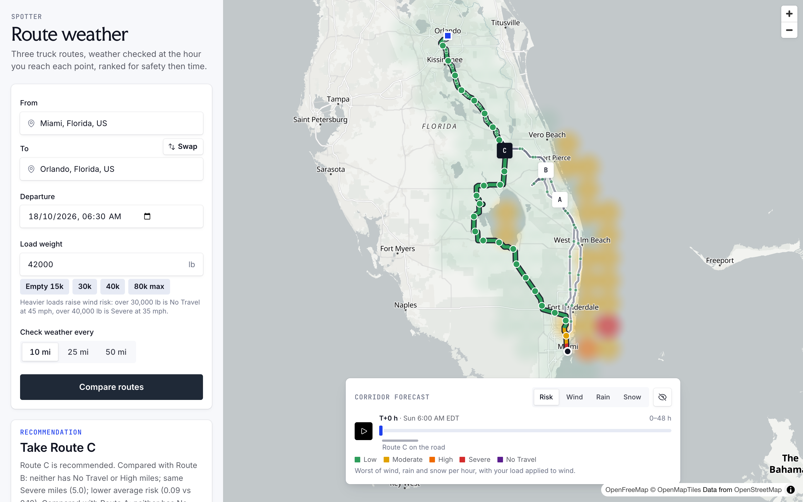
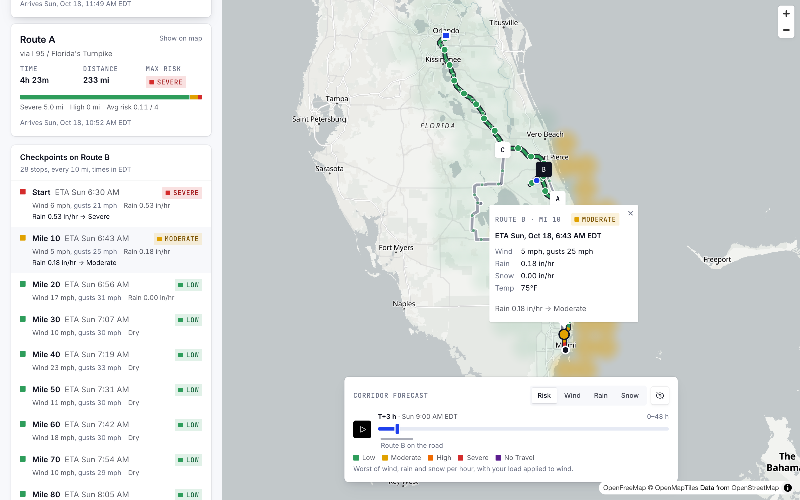
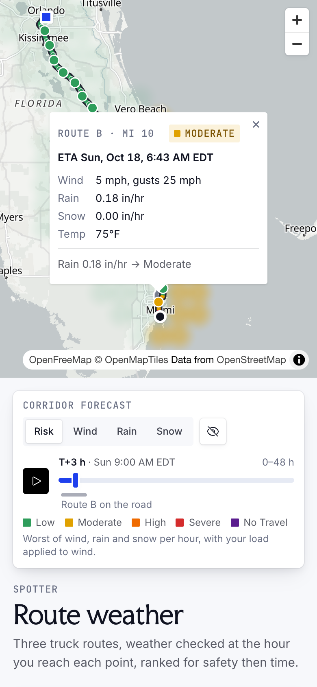
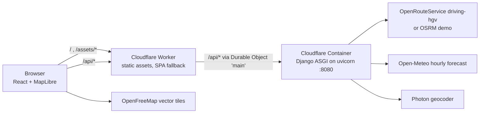

# Weather-aware truck routing

A React + Django app that helps a truck driver pick the safest of three routes. You enter an origin, a destination, a departure time and a load weight. The app gets three routes and places checkpoints every 10, 25 or 50 miles along each. It reads the forecast at the time the truck will reach each checkpoint, scores the weather risk with the load rules, and recommends a route: fewest No Travel miles first, then Severe miles, High miles, average risk and travel time. A map shows every route, checkpoint, risk level and ETA, plus a 0-48 hour weather heatmap of the trip corridor with a time slider.

**Live:** https://spotter.shafu.xyz (also https://spotter-ai.shafu.workers.dev)



| Checkpoint detail | Phone (390 px) |
|---|---|
|  |  |

The screenshots show a real run: Miami to Orlando, 42,000 lb, 10 mi checkpoints, leaving Sun 18 Oct 2026 at 06:30 EDT. Miami had forecast rain of 0.53 in/hr at that hour, which is Severe.

## Architecture



- **One origin.** The Worker serves the React build as static assets. Only `/api/*` runs Worker code, which forwards it to the container. No CORS is needed.
- **One container instance** (`getByName("main")`). Every request reaches the same Django process, so its in-memory cache is shared. The container sleeps after 15 min idle. The Worker retries cold starts for about 9 s.
- **Django is a stateless JSON API.** It has no database. All logic is in `backend/routing/services/`, and the views are thin.

## How the logic works

### 1. Routes (`routing_providers.py`)
- With `ORS_API_KEY` set, routes come from OpenRouteService `driving-hgv`, with `vehicle_type: hgv` and the load as `restrictions.weight` in tonnes. Without the key, the keyless OSRM demo server is used, which only has a car profile. The public ORS API is intermittently slow (we measured 2.5 s to 40 s+ for the same request), so ORS and OSRM run concurrently: ORS gets a 10 s overall budget (8 s per call) and wins when it returns at least as many routes as OSRM; otherwise the OSRM routes are shown with a warning. An ORS failure or blown budget skips ORS for 5 minutes. ORS `alternative_routes` is only requested for trips up to 90 km, since the public API rejects it above 100 km.
- The provider's own alternatives are used first. Missing routes are filled with **detours**:
  - The route is forced through a waypoint at the midpoint of the origin-destination line, offset sideways by ±8% of the straight-line distance, then ±15% if routes are still missing.
  - A candidate is dropped if more than 90% of it lies within 1 km of a route already accepted (checked both ways), or if it takes more than 1.6x the fastest route.
- Verified live:
  - OSRM gave only 2 alternatives for Dallas to Denver; a detour supplied the third.
  - ORS rejects `alternative_routes` for routes over 100 km (error 2004). The backend then retries without alternatives and detours fill the gap.
- Routes are sorted by duration and named Route A/B/C. Each description lists its main roads ("via US 287 / I 25"): numbered routes come first, and a route that would repeat another's description names a road the other one doesn't use.
- If fewer than 3 distinct routes exist, the response says so in `warnings`.
- A route whose ends snap more than 15 mi from the requested places is rejected ("no drivable road route"). Without this, New York to London came back as a route through Europe.

### 2. Checkpoints and ETAs (`sampling.py`)
- There is a checkpoint at the origin (mile 0), one every `interval_mi` along the route geometry, and one at the destination.
- Distances are haversine along the polyline, scaled to the provider's reported distance, so every mile figure in the API agrees.
- ETAs come from the provider's own durations, not a flat average speed:
  - OSRM: per-segment `annotation.duration`.
  - ORS: per-step durations, spread over each step's vertices by distance.
  - Each vertex gets a cumulative time. A checkpoint's ETA is interpolated linearly by distance within its segment, so slow city miles and fast interstate miles keep their real speeds.
- **Owned miles:** each checkpoint owns the miles from the midpoint with its previous checkpoint to the midpoint with its next one. Owned miles add up exactly to the route length.

### 3. Weather (`weather.py`)
- Data comes from Open-Meteo, hourly, in mph, inches and °F, with UTC times.
- Rain = `rain + showers`; snow = `snowfall`. Open-Meteo's hourly precipitation is the total over the preceding hour, so it is already in/hr.
- **Value at an ETA:**
  - Wind, gusts and temperature are instantaneous: linearly interpolated between the two forecast hours around the ETA.
  - Rain and snow are hourly totals: the value stamped H+1 covers H to H+1, so a truck at 08:20 gets the 09:00 value (the hour it is driving through). Interpolating totals like instants would lag 30-60 min.
  - `weather_code` is taken from the nearest hour.
- All values are quantized to 3 decimals (Open-Meteo's own resolution) before classification, so float noise (0.01 + 0.09 = 0.0999…) never drops a value sitting on a threshold to the lower level. The level always matches the value in the JSON.
- Points snap to a 0.05° grid and are deduplicated. Locations are sent in batches of 25 per request, up to 6 requests at once, with a 10 s timeout and one retry.
- **Cache:** one entry per (0.05° cell, UTC day, fetch hour), 30 min. Data is fetched in whole UTC days, so the route search, its heatmap and a re-search with a different departure reuse the same entries.
- **Quota guard:** a route search needing more than 500 unique weather cells is refused with a 400 that names a workable interval (`WEATHER_MAX_LOCATIONS`; off when `OPEN_METEO_API_KEY` is set). New York to Los Angeles needs ~717 at 10 mi, which alone exceeds the free tier's ~600 per minute and would otherwise always fail with a 502; at 25 mi it needs ~335.

### 4. Risk (`risk.py`)

| Condition | Low | Moderate | High | Severe | No Travel |
|---|---|---|---|---|---|
| Wind (sustained, mph) | < 25 | 25 to < 35 | 35 to < 45 | 45 to < 55 | ≥ 55 |
| Rain (in/hr) | < 0.10 | 0.10 to < 0.25 | 0.25 to < 0.50 | 0.50 to ≤ 1.00 | > 1.00 |
| Snow (in/hr) | < 0.5 | 0.5 to < 1.0 | 1.0 to < 2.0 | 2.0 to ≤ 3.0 | > 3.0 |

- **Load rules change only the wind level:**
  - wind ≥ 55 mph: No Travel for any load
  - 45 to < 55 mph with more than 30,000 lb: No Travel
  - 35 to < 45 mph with more than 40,000 lb: Severe
- **Checkpoint level** = highest of (load-adjusted wind, rain, snow).
- Each checkpoint lists its per-condition levels and plain-English drivers, e.g. "Wind 38 mph + 42,000 lb load -> Severe".

### 5. Recommendation (`recommend.py`)
- Routes are sorted on `(no_travel_mi, severe_mi, high_mi, avg_risk, duration_s)`, lowest first.
  - No Travel miles come first because they are strictly worse than Severe.
  - Miles are compared after rounding to 0.1 mi, and average risk after rounding to 0.01, so float noise never decides.
  - Any real mileage counts as at least 0.1 mi. A destination checkpoint that owns 0.02 mi of No Travel never ranks as clean, and `no_safe_route`, the warnings and the explanation (which shows it as "<0.1") all read the same value.
- `avg_risk` is the mean checkpoint level (0-4), weighted by owned miles.
- The explanation names the criterion that put the winner ahead of each other route, e.g. "same Severe miles (5.0); lower average risk (0.09 vs 0.11)".
- If every route has No Travel miles, the response sets `no_safe_route: true` with a warning, and the least-bad route is still ranked first. Otherwise, a winner that still has Severe or No Travel checkpoints gets a warning naming its worst level.

### 6. Heatmap (`heatmap.py`, `frontend/src/lib/heatmap.ts`)
- **Backend grid:**
  - A regular lat/lon grid. Its spacing is a multiple of 0.05° and at least 15 km, and it grows until the grid has at most 300 points within 40 km of any route.
  - Each point carries 49 hourly values (hours 0-48 from departure, rounded down to the hour): load-adjusted risk, wind, precipitation and snow.
  - Hour h is the hour starting at `start + h`: wind at that stamp, rain and snow from the total for h to h+1 (stamped h+1, so 50 hours are fetched). Checkpoints use the same convention.
  - Hours past the forecast horizon are `null`.
- **Frontend, built for smooth sliding:**
  - The grid is uploaded to MapLibre once per response. Each hour is stored as its own feature property (`r0..r48`, `w0..w48`, ...).
  - Moving the slider or switching the metric only swaps the property the circle colour reads. That is one `setPaintProperty` per animation frame, and no data is sent again.
  - Soft overlapping circles sized to the grid spacing show each cell's true level. MapLibre's built-in heatmap layer was not used because it adds up neighbouring values, which would misstate a 0-4 level.
  - `null` hours are drawn transparent, not as Low.
  - The heat source's tiles stop at z4 and are overzoomed above it. MapLibre draws a circle only from the tile that holds its centre, so with native z11+ tiles (narrower than one disc) the wash disappeared when zoomed in.
- The slider shows the selected route's departure-to-arrival window, and a dot shows where the truck would be at the slider hour.

## Assumptions

- Risk levels are 0 Low, 1 Moderate, 2 High, 3 Severe, 4 No Travel.
- **Bucket boundaries:** the lower bound is inclusive and the upper bound exclusive. The table writes the top rain and snow buckets as "> 1.00" and "> 3.0", so exactly 1.00 in/hr rain and exactly 3.0 in/hr snow are Severe. Wind of exactly 55 mph is No Travel ("≥ 55"). Raw floats are compared with no rounding.
- **Wind** is classified on sustained 10 m wind. Gusts are shown for information only.
- **Load rules** modify the wind level only (see the risk section). "Over 30,000 / 40,000 lb" is strict (`>`).
- **Checkpoints:** origin, every interval, destination. A route shorter than the interval gets the origin and destination only.
- **ETA** = departure + cumulative provider duration at that distance, interpolated within each segment. There are no rest breaks or hours-of-service stops.
- **Weather at a checkpoint** is read at the 0.05° cell the checkpoint falls in. Wind is linearly interpolated between the two forecast hours around its ETA. Rain and snow come from the hourly total for the hour containing the ETA.
- **Recommendation order:** No Travel miles, Severe miles, High miles, average risk (distance-weighted), travel time.
- **Exactly 3 routes when possible**, from provider alternatives plus perpendicular detours. Fewer comes back with a warning.
- **Departure** is ISO 8601 with a UTC offset. It is rejected if more than 1 h in the past, or if the longest route would end after the Open-Meteo horizon (23:00 UTC on today + 15 days).
- **Heatmap hours** run 0-48 from the departure rounded down to the hour, in UTC.
- **ORS weight** is the cargo weight in tonnes, not the gross vehicle weight.
- **Caching** uses Django LocMemCache: weather 30 min per (cell, UTC day, fetch hour), routing 15 min, geocoding 1 day. The fetch hour stands in for the model run hour, which Open-Meteo does not report.

## API

All endpoints return JSON. Errors are always `{"error": str}`: 400 for bad input, 502 when an upstream provider fails or rate-limits, and 404/405 for unknown paths or methods.

| Endpoint | Purpose |
|---|---|
| `GET /api/health` | `{"ok": true, "routing_provider": "ors" or "osrm"}` (no upstream calls; it is the container's readiness probe) |
| `GET /api/geocode?q=&limit=5` | Photon place search. Queries under 3 characters return `[]` |
| `POST /api/routes` | `{origin, destination, departure, load_lb, interval_mi}` returns 3 routes with checkpoints, summaries and the recommendation. 400 if the search needs more than 500 weather cells (see Weather) |
| `POST /api/heatmap` | `{departure, load_lb, lines}` returns the corridor grid with 49 hourly values per point |

## Local development

Requirements: Python 3.12 with [uv](https://docs.astral.sh/uv/), Node 22, pnpm 10.

```bash
pnpm install                       # root tooling (wrangler)
pnpm --dir frontend install
(cd backend && uv sync)            # creates backend/.venv
pnpm dev                           # Django on :8000 + Vite on :5173 (proxies /api to :8000)
```

Open http://localhost:5173. Set `ORS_API_KEY` in the backend's environment to use the truck (HGV) profile. Without it, the backend uses OSRM.

`http://localhost:5173/?fixture=1` (dev only) renders a bundled sample trip with made-up storm weather. It needs no backend and shows every risk level.

## Tests

```bash
cd backend && .venv/bin/pytest -q              # 168 tests, all upstream HTTP mocked (respx)
cd backend && uvx ruff check . && uvx ruff format --check .
cd frontend && pnpm test                       # 93 vitest tests
cd frontend && pnpm build                      # tsc + vite production build
pnpm typecheck                                 # Worker TypeScript
```

Backend tests cover:
- every threshold boundary and each load rule
- owned miles adding up to the route length
- ETA interpolation
- the order of the recommendation criteria and its explanation
- detour dedupe
- heatmap grid budget
- the API contract and error codes

## Deploy (Cloudflare Workers + Containers)

Requirements:
- A Cloudflare account on the **Workers Paid plan** ($5/mo). Containers are not available on Free.
- Docker running locally. Wrangler builds and pushes the linux/amd64 image.
- Node 22 and pnpm 10.

1. `pnpm install && pnpm --dir frontend install` (the frontend has its own lockfile; the root install does not cover it)
2. `pnpm wrangler login`
3. Set the secrets:
   ```bash
   pnpm wrangler secret put DJANGO_SECRET_KEY   # required
   pnpm wrangler secret put ORS_API_KEY         # optional; without it routing uses the public OSRM demo server
   ```
4. `pnpm run deploy`. This builds the frontend, builds and pushes the backend image, and deploys the Worker. Use `pnpm run deploy`, not `pnpm deploy`, which is a built-in pnpm command.
5. Wait 2-5 minutes after the first deploy for the container to be provisioned. Until then `/api/*` returns 503 "starting up".

Useful commands:
- `pnpm run deploy:dry`: validate the config.
- `pnpm cf:tail`: live logs.
- `pnpm wrangler containers list`: list containers.
- `pnpm wrangler deploy --containers-rollout=none`: deploy without rebuilding the image.

## Project structure

```
backend/                    Django project "config", app "routing"
  routing/views.py          thin async JSON views
  routing/schemas.py        pydantic request validation
  routing/middleware.py     dev CORS, JSON error bodies
  routing/services/         planner, routing_providers, sampling, weather, risk, recommend, heatmap, geocode, geo
  tests/                    pytest + respx
  Dockerfile                python:3.12-slim, non-root, one uvicorn worker on :8080
frontend/                   Vite + React 19 + TypeScript, Tailwind v4, MapLibre GL
  src/api/                  contract types + fetch client
  src/components/form/      trip form, place autocomplete, validation
  src/components/results/   recommendation, route cards, checkpoint list
  src/components/map/       map, route + checkpoint layers, heat layer, forecast panel, truck marker
  src/components/primitives design system primitives copied from pocketwebtools (button, input, slider, ...)
  src/lib/                  risk palette, formatting, geometry, heatmap expressions
worker/src/index.ts         Worker: /api/* -> container (cold-start retry), else static assets
wrangler.jsonc              Worker + assets + container config
docs/                       screenshots, Loom script
```

## Limitations

- **Average risk favours longer routes.** Because the average is distance-weighted, the same bad stretch counts for less on a longer route. In the Miami to Orlando example, the routes have identical Severe and High miles, and Route C (5 h 57 min) wins over Route A (4 h 23 min) on average risk 0.09 vs 0.11. That follows the required rule order but may not be what a driver wants. Possible fixes are risk-weighted miles (sum of level x miles) or a time tolerance; I have not applied either.
- **No truck restrictions without an ORS key.** The OSRM demo uses a car profile, so it ignores bridge heights, weight limits and truck routes, and its durations are car speeds. With ORS, durations come from the HGV profile.
- **Open-Meteo free tier** allows about 600 locations per minute, and every location counts.
  - A search uses one location per unique 0.05° checkpoint cell, and its heatmap up to 300 more. Chicago to Dallas at 10 mi is ~250 + ~250; New York to Los Angeles at 25 mi is ~335 + ~275.
  - Searches over 500 cells are refused up front (see Weather). A cross-country 25 mi search plus its heatmap can still reach ~600 from a cold cache, and back-to-back cold searches within a minute can get a 502 asking to retry. Repeat searches and departure changes on the same days hit the cache.
  - Latency varies: requests of 25 or more locations sometimes take over 10 s, which is why batches are 25 locations with one retry.
- **The cache is in memory.** It is lost when the container sleeps (after 15 min idle) or is redeployed.
- **Heatmap edge at tile seams.** Above z4, the wash for a view within ~0.3° of a z4 tile edge (for example lon -90°, near Memphis) is missing the discs from just across the edge, so it fades there instead of disappearing.
- **Coarse weather.** Weather is a model forecast at the 0.05° cell (about 5 km), not a road-surface observation. The heatmap grid is coarser (about 0.3° on long trips), so it shows corridor trends rather than checkpoint detail.
- **No rest stops in ETAs.** A 14 h trip is treated as 14 h of driving, with no hours-of-service breaks.
- **Docker build not run locally.** The image build was not checked here because Docker was not running. The same requirements and uvicorn command were checked in a local venv.
